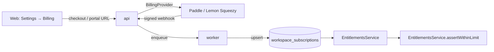

# Billing & Entitlements

Product side: [Business model](../product/business-model.md). Decision: [ADR-0010 Merchant of Record billing](../adr/0010-merchant-of-record-billing.md).

> This is Billleaf charging **its** customers (SaaS subscription). Freelancers invoicing **their** clients is the Invoices module — unrelated code.

## Components (`apps/api/src/billing/`)



### `BillingProvider` interface

```ts
interface BillingProvider {
  createCheckout(input: { workspaceId: string; planKey: string; interval: 'month' | 'year' }): Promise<{ url: string }>
  createPortalSession(workspaceId: string): Promise<{ url: string }>
  verifyWebhook(rawBody: Buffer, headers: Record<string, string>): Promise<BillingEvent>
}
type BillingEvent =
  | { type: 'subscription.activated' | 'subscription.updated' | 'subscription.canceled' | 'subscription.past_due'; … }
```

- Provider adapters: `PaddleBillingProvider`, `LemonSqueezyBillingProvider` (one active, chosen by env). Stripe can be added later.
- Webhooks: verify signature on the raw body → store event id (idempotency) → enqueue → worker upserts `workspace_subscriptions`.
- `workspace_subscriptions` is the only state we keep; the provider is the source of truth for payment details and tax.

## Entitlements

- **Plan catalog:** each plan key (`free`, `pro`, `team`) maps to entitlements — limits (`clients.max`, `invoices.per_month`, `members.max`, `storage.mb`) and flags (`branding.custom`, `time.enabled`, `recurring.enabled`, `rbac.custom_roles`, `portal.enabled`).
- The catalog starts in code (`@workspace/contracts`) for type safety; per-workspace overrides (grandfathering, promos) and DB-driven plan values can be layered in so pricing changes need no feature-code changes.
- `EntitlementsService.get(workspaceId)` → resolved entitlements (cached in Valkey, invalidated on subscription change).

### Enforcement

```ts
@RequireEntitlement('time.enabled')           // feature flag → 402/403 problem+json
await this.entitlements.assertWithinLimit('clients.max', currentCount + 1)
```

- Feature code checks **entitlement keys**, never plan names.
- Limit errors return problem+json with `type: …/errors/plan-limit` so the web can show an upgrade prompt.
- Downgrades never delete data: over-limit workspaces become read-only for that resource.

## States

`active` · `trialing` · `past_due` (grace period, banner) · `canceled` (falls back to `free` at period end).

## Open items

- Confirm MoR availability for the operating company's jurisdiction.
- Final prices and limits.
