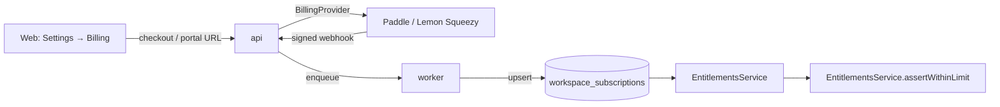

# Billing & Entitlements

Product side: [Business model](../product/business-model.md). Decisions: [ADR-0010 Merchant of Record billing](../adr/0010-merchant-of-record-billing.md), [ADR-0011 Billing core with a test provider](../adr/0011-billing-core-with-test-provider.md), [ADR-0013 Manual subscription payments](../adr/0013-manual-payments-for-subscriptions.md).

> This is Billleaf charging **its** customers (SaaS subscription). Freelancers invoicing **their** clients is the Invoices module — unrelated code.

## Components (`apps/api/src/billing/`)

### Status

Implemented: plans, entitlement enforcement, subscription state, webhook pipeline, Settings → Billing, a **test provider** (`BILLING_PROVIDER=test`, unavailable in production) and the **manual provider** used in production (`BILLING_PROVIDER=manual`, ADR-0013). An online provider (Paddle, Lemon Squeezy or a local gateway) can be added later as another adapter.

### `BillingProvider` (`billing/providers/billing-provider.ts`)

- `createCheckout`, `createPortalSession`, `changePlan`, and `parseWebhook(rawBody, headers)`, which verifies the signature and normalises the payload into a `BillingEvent` (`subscription.activated | updated | canceled`, plan, interval, status, period end, cancel-at-period-end, workspace id from the checkout's custom data).
- Adding a provider: implement the interface, add its key to `BILLING_PROVIDER` and the factory in `BillingModule`, and point its webhooks at `POST /v1/billing/webhooks/<key>`.

### Webhook pipeline

`POST /v1/billing/webhooks/:provider` (anonymous, raw body kept by the body parser) → verify → insert `billing_events` (unique `provider + event_id`; duplicates return `duplicate: true`) → apply in a transaction (upsert `workspace_subscriptions`, skipping events older than `last_event_at`) → mark processed. If applying fails, the error is stored, the provider still gets a 200, and the `billing` queue retries with backoff.

### Test provider

Checkout and portal URLs open `/<workspace>/settings/billing/test?session=…` (a signed, 30-minute token bound to the workspace). "Pay (test)" and the portal actions (cancel / resume / payment failed / recovered / end now) are sent as signed webhooks through the pipeline above. In production the test provider is unavailable: checkout returns `billing_unavailable` and its webhooks are refused even when correctly signed (the default secret is public).

### Manual provider (production)

Workspaces pay Billleaf by bank transfer or mobile wallet and a platform admin approves the proof (`billing/manual/`).

| Piece                                              | What it does                                                                                                                                                                                            |
| -------------------------------------------------- | ------------------------------------------------------------------------------------------------------------------------------------------------------------------------------------------------------- |
| `platform_prices`                                  | Price per plan × interval × currency (minor units), set in Admin → Pricing                                                                                                                              |
| `platform_payment_accounts`                        | Billleaf's bank accounts / wallets with QR images (`_platform/payment-qr/…`), Admin → Pricing                                                                                                           |
| `GET /v1/billing/manual/options`                   | Active prices, accounts and the pending request (`billing.read`)                                                                                                                                        |
| `POST /v1/billing/manual/payments`                 | Multipart proof (PNG/JPEG ≤ 2 MB, `_platform/subscription-proofs/<ws>/…`); amount = price × periods; one pending per workspace (`billing.manage`); emails `PLATFORM_ADMIN_EMAILS`                       |
| `POST /v1/admin/subscription-payments/:id/approve` | `pending → approved` once (409 after), then `BillingService.applyDirect` with event `manual-<id>`; same plan before its end stacks, else starts now; `cancel_at_period_end = true`; emails the owners   |
| `…/reject`                                         | Stores the reason and emails the owners                                                                                                                                                                 |
| Reminders                                          | Hourly `reminders` job on the `billing` queue: 7 days and 1 day before the end, and once after it ended; `last_reminder` = `<stage>@<period end>`                                                       |
| Grace                                              | `effectivePlan()` keeps a `manual` plan for `MANUAL_GRACE_DAYS` (7) after the end; `/v1/billing` returns `graceEndsAt`, and the app shell shows a banner in the last 7 days and during the grace period |

Billing periods are calendar months/years in UTC, clamped at month end (`billing/period.ts`: Jan 31 + 1 month = Feb 28).

## Entitlements

- **Plan catalog:** `PLANS` in `@workspace/contracts` (shared with the web pricing UI) maps `free`, `pro`, `team` to limits (`members`, `clients`, `invoicesPerMonth`, `storageMb`) and features (`customBranding`, `recurringInvoices`, `timeTracking`, `customRoles`). Prices there are display-only; the provider charges.
- **Effective plan:** `effectivePlan()` — canceled → Free; scheduled cancellation → Free once the period ends (manual plans: 7 days later); past due → keeps the plan for 14 days after the period end. `/v1/me` returns the effective plan and its features for UI hints.
- The catalog starts in code (`@workspace/contracts`) for type safety; per-workspace overrides (grandfathering, promos) and DB-driven plan values can be layered in so pricing changes need no feature-code changes.
- `EntitlementsService.get(workspaceId)` → resolved entitlements (cached in Valkey, invalidated on subscription change).

### Enforcement

| Entitlement         | Where                      | Behaviour                                                                                                |
| ------------------- | -------------------------- | -------------------------------------------------------------------------------------------------------- |
| `members`           | invitations                | blocked at invite                                                                                        |
| `clients`           | create / restore client    | counts active (non-archived) clients                                                                     |
| `invoicesPerMonth`  | issuing an invoice         | drafts are never limited; counts invoices issued this month (workspace timezone); soft under concurrency |
| `storageMb`         | file uploads               | sum of stored file sizes                                                                                 |
| `customBranding`    | PDFs                       | without it: default colours, no logo, "Made with Billleaf" footer                                        |
| `recurringInvoices` | create / resume / generate | schedules pause if the plan loses it                                                                     |
| `customRoles`       | create / edit roles        | system roles keep working                                                                                |

`EntitlementsService.assertWithinLimit` / `assertFeature` throw 403 problem+json with `plan_limit_reached` / `feature_not_in_plan` and a message naming the plan and limit; the web shows it plus a "See plans" prompt. Downgrades never delete data: over-limit workspaces just can't add more.

## States

`active` · `trialing` · `past_due` (grace period, banner) · `canceled` (falls back to `free` at period end).

## Open items

- Online payments once a provider serves the operating company's country (MoR or a local gateway).
- Final prices and limits.
