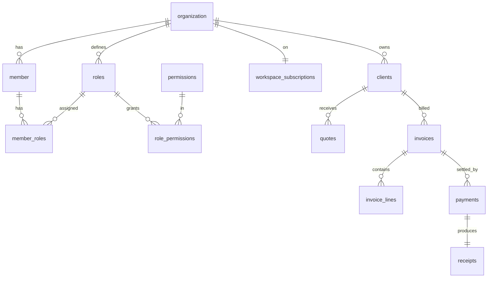

# Data Model

Decision: [ADR-0003 PostgreSQL + Drizzle](../adr/0003-postgres-drizzle.md). Source of truth: `packages/db/src/schema/`.

## Conventions

| Rule           | Detail                                                                                                                                |
| -------------- | ------------------------------------------------------------------------------------------------------------------------------------- |
| IDs            | **UUIDv7** (time-ordered) for app tables                                                                                              |
| Naming         | `snake_case` tables/columns, plural table names for app tables                                                                        |
| Timestamps     | `created_at`, `updated_at` (timestamptz); `deleted_at` for soft delete where needed                                                   |
| Tenancy        | Every business table has `workspace_id` (FK, indexed, leading column in composite unique keys) — [multi-tenancy.md](multi-tenancy.md) |
| Money          | **Integer minor units** (`amount_minor bigint`) + **ISO 4217 currency** (`char(3)`). No floats, ever                                  |
| Financial docs | Issued quotes/invoices/receipts are **immutable**; corrections via void / credit note                                                 |
| Numbering      | Per-workspace gap-free sequences (`INV-0001`) via `document_sequences` (row-locking `UPDATE … RETURNING`)                             |
| Audit          | Sensitive actions → `audit_logs` (actor, workspace, action, resource, metadata, ip, user agent)                                       |
| Idempotency    | Payment/webhook handlers store idempotency keys                                                                                       |

## Current tables (Phase 0)

### Auth (Better Auth, `auth.ts`)

| Table          | Notes                                                                              |
| -------------- | ---------------------------------------------------------------------------------- |
| `user`         | Platform user; `role` used only by the Better Auth `admin` plugin (platform staff) |
| `session`      | Includes `active_organization_id` (= active workspace)                             |
| `account`      | Credentials / OAuth accounts                                                       |
| `verification` | Email verification, magic link / OTP                                               |
| `organization` | **= workspace** (name, slug, logo, metadata)                                       |
| `member`       | User ↔ workspace membership                                                        |
| `invitation`   | Pending invites                                                                    |
| `two_factor`   | 2FA secrets (plugin)                                                               |

Exact columns follow the Better Auth schema for the enabled plugins; regenerate when plugins change.

### IAM (`iam.ts`)

| Table                | Columns (key)                                                                                                                      |
| -------------------- | ---------------------------------------------------------------------------------------------------------------------------------- |
| `permissions`        | `id`, `key` (`invoice.create`), `resource`, `action`, `description` — synced from code catalog                                     |
| `roles`              | `id`, `workspace_id`, `slug`, `name`, `description`, `is_system`, `is_locked` (templates live in code: `SYSTEM_ROLES`)             |
| `role_permissions`   | `role_id`, `permission_id`                                                                                                         |
| `member_roles`       | `member_id`, `role_id`, `workspace_id` (denormalized for scoping)                                                                  |
| `audit_logs`         | `workspace_id`, `actor_user_id`, `action`, `resource_type`, `resource_id`, `metadata`, `ip_address`, `user_agent`, `created_at`    |
| `document_sequences` | PK (`workspace_id`, `scope`), `prefix`, `padding`, `next_value` — incremented with `UPDATE … RETURNING` in the issuing transaction |

### Billing (`billing.ts`)

| Table                     | Notes                                                                                                           |
| ------------------------- | --------------------------------------------------------------------------------------------------------------- |
| `workspace_subscriptions` | `workspace_id` (PK), `plan_key`, `status`, `provider`, provider customer/subscription ids, `current_period_end` |

## Planned business tables (Phase 1+)

`clients`, `contacts`, `quotes`, `quote_lines`, `invoices`, `invoice_lines`, `tax_rates`, `payments`, `receipts`, `files`, `notifications`, then `projects`, `tasks`, `time_entries`, `contracts`, `contract_templates`.

## Migrations

- Drizzle Kit generates SQL migrations (`pnpm db:generate`) committed to `packages/db`.
- Apply with `pnpm db:migrate`; in deploys a one-off **migrate job** runs before the api rolls ([deployment](../infrastructure/deployment.md)).
- Migrations are **forward-only** and must be backward compatible with the previous api version (expand → migrate data → contract).
