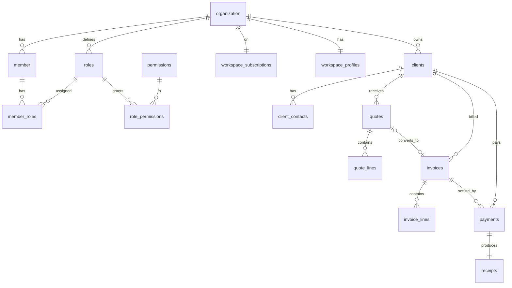

# Data Model

Decision: [ADR-0003 PostgreSQL + Drizzle](../adr/0003-postgres-drizzle.md). Source of truth: `packages/db/src/schema/`.

## Conventions

| Rule           | Detail                                                                                                                                |
| -------------- | ------------------------------------------------------------------------------------------------------------------------------------- |
| IDs            | **UUIDv7** (time-ordered) for app tables                                                                                              |
| Naming         | `snake_case` tables/columns, plural table names for app tables                                                                        |
| Timestamps     | `created_at`, `updated_at` (timestamptz); `deleted_at` for soft delete where needed                                                   |
| Tenancy        | Every business table has `workspace_id` (FK, indexed, leading column in composite unique keys) — [multi-tenancy.md](multi-tenancy.md) |
| Money          | **Integer minor units** (`amount_minor bigint`) + **ISO 4217 currency** (`char(3)`). No floats, ever                                  |
| Financial docs | Issued quotes/invoices/receipts are **immutable**; corrections via void / credit note                                                 |
| Numbering      | Per-workspace gap-free sequences (`INV-0001`) via `document_sequences` (row-locking `UPDATE … RETURNING`)                             |
| Audit          | Sensitive actions → `audit_logs` (actor, workspace, action, resource, metadata, ip, user agent)                                       |
| Idempotency    | Payment/webhook handlers store idempotency keys                                                                                       |

## Current tables (Phase 0)

### Auth (Better Auth, `auth.ts`)

| Table          | Notes                                                                              |
| -------------- | ---------------------------------------------------------------------------------- |
| `user`         | Platform user; `role` used only by the Better Auth `admin` plugin (platform staff) |
| `session`      | Includes `active_organization_id` (= active workspace)                             |
| `account`      | Credentials / OAuth accounts                                                       |
| `verification` | Email verification, magic link / OTP                                               |
| `organization` | **= workspace** (name, slug, logo, metadata)                                       |
| `member`       | User ↔ workspace membership                                                        |
| `invitation`   | Pending invites                                                                    |
| `two_factor`   | 2FA secrets (plugin)                                                               |

Exact columns follow the Better Auth schema for the enabled plugins; regenerate when plugins change.

### IAM (`iam.ts`)

| Table                | Columns (key)                                                                                                                      |
| -------------------- | ---------------------------------------------------------------------------------------------------------------------------------- |
| `permissions`        | `id`, `key` (`invoice.create`), `resource`, `action`, `description` — synced from code catalog                                     |
| `roles`              | `id`, `workspace_id`, `slug`, `name`, `description`, `is_system`, `is_locked` (templates live in code: `SYSTEM_ROLES`)             |
| `role_permissions`   | `role_id`, `permission_id`                                                                                                         |
| `member_roles`       | `member_id`, `role_id`, `workspace_id` (denormalized for scoping)                                                                  |
| `audit_logs`         | `workspace_id`, `actor_user_id`, `action`, `resource_type`, `resource_id`, `metadata`, `ip_address`, `user_agent`, `created_at`    |
| `document_sequences` | PK (`workspace_id`, `scope`), `prefix`, `padding`, `next_value` — incremented with `UPDATE … RETURNING` in the issuing transaction |

### Billing (`billing.ts`)

| Table                     | Notes                                                                                                           |
| ------------------------- | --------------------------------------------------------------------------------------------------------------- |
| `workspace_subscriptions` | `workspace_id` (PK), `plan_key`, `status`, `provider`, provider customer/subscription ids, `current_period_end` |

### Workspace & clients (`workspace.ts`, `clients.ts`) — Phase 1

| Table                | Notes                                                                                                                                                                                                                                                          |
| -------------------- | -------------------------------------------------------------------------------------------------------------------------------------------------------------------------------------------------------------------------------------------------------------- |
| `workspace_profiles` | `workspace_id` (PK) — legal name, contact, address, `default_currency`, `timezone`, `locale`, `payment_terms_days`, `default_tax_rate_bps`, footer, brand color. Created on workspace bootstrap (or lazily on first read)                                      |
| `clients`            | `workspace_id`, `type` (company/individual), contact + address fields, optional `currency` / `payment_terms_days` overrides (null = workspace default), `notes`, `archived_at`, `deleted_at` (soft delete). Listed newest-first by UUIDv7 `id` (keyset cursor) |
| `client_contacts`    | `workspace_id`, `client_id`, name, email, phone, title, `is_primary` (at most one, enforced in the repository transaction)                                                                                                                                     |

Plan limit: active (non-archived) clients count against `PLANS[plan].limits.clients`; restoring an archived client re-checks the limit.

### Quotes (`quotes.ts`) — Phase 1

| Table         | Notes                                                                                                                                                                                                                                                                                                                                                              |
| ------------- | ------------------------------------------------------------------------------------------------------------------------------------------------------------------------------------------------------------------------------------------------------------------------------------------------------------------------------------------------------------------ |
| `quotes`      | `workspace_id`, `client_id` (FK, restrict), `number` (null while draft; unique per workspace), `status` (draft → sent → accepted/declined), `title`, `currency`, `issue_date`, `valid_until`, `notes`, `terms`, `subtotal`/`tax_total`/`total` (minor units), `client_snapshot` + `issuer_snapshot` (jsonb, frozen at send), `sent_at`/`accepted_at`/`declined_at` |
| `quote_lines` | `quote_id`, `position`, `description`, `quantity` (numeric 14,3), `unit_price` (minor units), `tax_rate_bps`, computed `amount`/`tax_amount`                                                                                                                                                                                                                       |

Rules: only drafts are editable/deletable; sending assigns the next `QUO-` number via `DocumentNumberingService` **inside the same transaction** (row lock on `document_sequences`) and freezes the snapshots. Line math (`lineAmounts`, `documentTotals` in `@workspace/contracts`) rounds half away from zero per line and is shared by the API and the web preview. "Expired" is derived (sent and `valid_until` before today in the workspace timezone). Clients referenced by quotes can be archived but not deleted.

### Invoices (`invoices.ts`) — Phase 1

| Table           | Notes                                                                                                                                                                                                                                                                                                                                                                                                                                                                        |
| --------------- | ---------------------------------------------------------------------------------------------------------------------------------------------------------------------------------------------------------------------------------------------------------------------------------------------------------------------------------------------------------------------------------------------------------------------------------------------------------------------------- |
| `invoices`      | `workspace_id`, `client_id` (restrict), `quote_id` (unique — one invoice per quote), `number` (null while draft; unique per workspace), `status` (draft → issued → void), dates (`issue_date`, `due_date`), totals in minor units, **`amount_paid`** (maintained by Payments), snapshots frozen on issue, `issued_at`, `voided_at` + `void_reason`, `last_sent_at` / `last_sent_to`, `recurring_id` + `recurring_period` (unique together — one invoice per schedule period) |
| `invoice_lines` | Same shape as `quote_lines`                                                                                                                                                                                                                                                                                                                                                                                                                                                  |

Payment/display state is **derived**, never stored: `invoiceState()` in `@workspace/contracts` gives `unpaid | partially_paid | paid` and `draft | open | overdue | partially_paid | paid | void` (overdue = issued, not fully paid, due before today in the workspace timezone); the list filter uses the equivalent SQL. Issuing assigns the next `INV-` number in the issuing transaction (voided numbers are never reused) and fills `due_date` from client → workspace payment terms. Invoices with payments must be refunded before voiding. Issued invoices are never edited.

PDFs (quotes and invoices) are rendered on demand by `renderDocumentPdf` (pdfkit, `GET /v1/{quotes|invoices}/:id/pdf`) and emailed as attachments through the BullMQ email queue.

### Payments & receipts (`payments.ts`) — Phase 1

| Table      | Notes                                                                                                                                                                                                                                                                          |
| ---------- | ------------------------------------------------------------------------------------------------------------------------------------------------------------------------------------------------------------------------------------------------------------------------------ |
| `payments` | `workspace_id`, `invoice_id` / `client_id` (restrict), `amount` (minor units, invoice currency), `paid_on`, `method` (bank_transfer, card, cash, cheque, online, other), `reference`, `notes`, `status` (completed / refunded), `refunded_at` + `refund_reason`, `recorded_by` |
| `receipts` | One per payment (unique `payment_id`), `number` (`RCT-0001`, gap-free per workspace), frozen client/issuer snapshots, **`balance_after`** (invoice balance right after the payment), `voided_at` (set on refund), `last_sent_at` / `last_sent_to`                              |

Recording a payment locks the invoice row (`SELECT … FOR UPDATE`), rejects overpayment (`overpayment`) and payments on non-issued or fully paid invoices, inserts the payment, increments `invoices.amount_paid` and issues the receipt — all in one transaction. A refund (recording that money was returned; Billleaf moves no money) marks the payment refunded, decrements `amount_paid` and voids the receipt. Invoices with `amount_paid > 0` cannot be voided.

### Files (`files.ts`)

| Table   | Notes                                                                                                                                                                                                                                                                                                              |
| ------- | ------------------------------------------------------------------------------------------------------------------------------------------------------------------------------------------------------------------------------------------------------------------------------------------------------------------ |
| `files` | `workspace_id`, `key` (`<workspaceId>/<purpose>/<uuid>.<ext>`, unique), `purpose` (logo, attachment), `filename`, `content_type`, `size`, `created_by`. Bytes live in S3-compatible storage (SeaweedFS locally, Cloudflare R2 in production); the bucket is private and browsers get 15-minute presigned GET URLs. |

`workspace_profiles.logo_file_id` → `files.id` (set null). Logo uploads are PNG/JPEG ≤ 1 MB, validated by **magic bytes** (the client's content-type is ignored). Replacing or removing a logo deletes the old object.

### Projects & tasks (`projects.ts`) — Phase 2

| Table      | Notes                                                                                                                                                                                                                                                                                                                |
| ---------- | -------------------------------------------------------------------------------------------------------------------------------------------------------------------------------------------------------------------------------------------------------------------------------------------------------------------- |
| `projects` | `workspace_id`, `client_id` (nullable = internal; restrict), `quote_id` (set null), `name`, `description`, `status` (active / on_hold / completed / archived), `billing` (hourly / fixed / non_billable), `currency`, `budget_amount` (fixed) **or** `hourly_rate` (hourly) in minor units, `start_date`, `due_date` |
| `tasks`    | `project_id` (cascade), `title`, `notes`, `status` (todo / in_progress / done), `position` (double — fractional ordering within a status column), `due_date`, `assignee_member_id` (set null), `completed_at`                                                                                                        |

Task moves send `afterTaskId` (null = top) and optionally a new `status`; the API places the task at the midpoint of its new neighbours and renumbers the column only when the gap gets too small. An accepted quote can start a fixed-price project budgeted at the quote total (one project per quote). Clients with projects can't be deleted.

### Time tracking (`time.ts`) — Phase 2

| Table          | Notes                                                                                                                                                                                                                                                                                                         |
| -------------- | ------------------------------------------------------------------------------------------------------------------------------------------------------------------------------------------------------------------------------------------------------------------------------------------------------------- |
| `time_entries` | `project_id` (restrict), `task_id` (set null), `member_id` (set null — kept when a member leaves), `member_name` (snapshot of who did the work), `description`, `entry_date` (workspace-local date), `started_at`, `ended_at` (null = running timer), `duration_seconds`, `billable`, `invoice_id` (set null) |

Rules: one running timer per member (partial unique index `WHERE ended_at IS NULL`; starting a timer stops the current one). Own entries need `time.track`, others' need `time.manage`, reading others' needs `time.read`. **Invoice from time** turns billable, finished, uninvoiced entries into a draft invoice (one line per task, hours = seconds rounded to 0.01 h, at the project's hourly rate); entries are claimed atomically and locked. Deleting that draft (FK set null) or voiding the invoice releases them. Projects with time can't be deleted. Removing a member stops their running timer and keeps all their entries (`member_id` → null, `member_name` retained); former members' entries are editable with `time.manage`.

### Contracts (`contracts.ts`) — Phase 2

| Table                | Notes                                                                                                                                                                                                                                                                                                                                                                                                        |
| -------------------- | ------------------------------------------------------------------------------------------------------------------------------------------------------------------------------------------------------------------------------------------------------------------------------------------------------------------------------------------------------------------------------------------------------------ |
| `contract_templates` | `name`, `body` (text with `{{merge.fields}}`) — copied into each contract, so editing a template never changes existing contracts                                                                                                                                                                                                                                                                            |
| `contracts`          | `client_id` (restrict), `template_id` / `quote_id` / `project_id` (set null), `number` (null while draft; unique per workspace), `status` (draft → sent → signed \| declined; sent/signed → void), `title`, `body` (source), `rendered_body` (frozen at send), `effective_date`, `end_date`, snapshots frozen at send, `sent_at`, `signed_at` + `signed_by_name`, `declined_at`, `voided_at` + `void_reason` |

Text is a small Markdown subset (headings, lists, paragraphs, `**bold**`) parsed by `parseContractText` in `@workspace/contracts`, which both the PDF renderer and the web preview use. Merge fields (`MERGE_FIELDS`: client, business, contract, quote, project, today) resolve live while draft; sending is refused (`unresolved_fields`) until every field resolves, _before_ a `CON-` number is taken, then the resolved text and both parties are frozen. Signatures are recorded manually (`contract.send`: who signed and when, not in the future); e-sign comes with the client portal. Only drafts are editable or deletable.

### Recurring invoices (`recurring.ts`) — Phase 2

| Table                | Notes                                                                                                                                                                                                                                                                                                                                                                                                 |
| -------------------- | ----------------------------------------------------------------------------------------------------------------------------------------------------------------------------------------------------------------------------------------------------------------------------------------------------------------------------------------------------------------------------------------------------- |
| `recurring_invoices` | `client_id` (restrict), `title`, `currency`, `lines` (jsonb template), `every` + `unit` (week/month/year), `start_date`, `anchor_day` (day of month from the start date), `end_date` / `max_occurrences` (optional), `next_run_date` (null once ended), `due_days` (null = payment terms), `mode` (`draft` or `send`), `status` (active/paused/ended), `generated_count`, `last_run_at`, `last_error` |

Each period creates one invoice dated that period (`invoices.recurring_period`); the `(recurring_id, recurring_period)` unique key plus a compare-and-set advance on `next_run_date` make generation idempotent across retries and concurrent workers. Monthly/yearly dates keep the anchor day, clamped to month end (Jan 31 → Feb 28 → Mar 31). In `send` mode the invoice is issued and emailed; a send failure is recorded in `last_error` without blocking the schedule. An hourly worker job (`recurring` queue) generates due periods in each workspace's timezone, catching up at most 12 per run. Gated by the plan's `recurringInvoices` feature; a downgraded workspace's schedules are paused. Deleting a schedule keeps its invoices.

## Planned business tables (Phase 1+)

`tax_rates`, `notifications`.

## Migrations

- Drizzle Kit generates SQL migrations (`pnpm db:generate`) committed to `packages/db`.
- Apply with `pnpm db:migrate`; in deploys a one-off **migrate job** runs before the api rolls ([deployment](../infrastructure/deployment.md)).
- Migrations are **forward-only** and must be backward compatible with the previous api version (expand → migrate data → contract).
