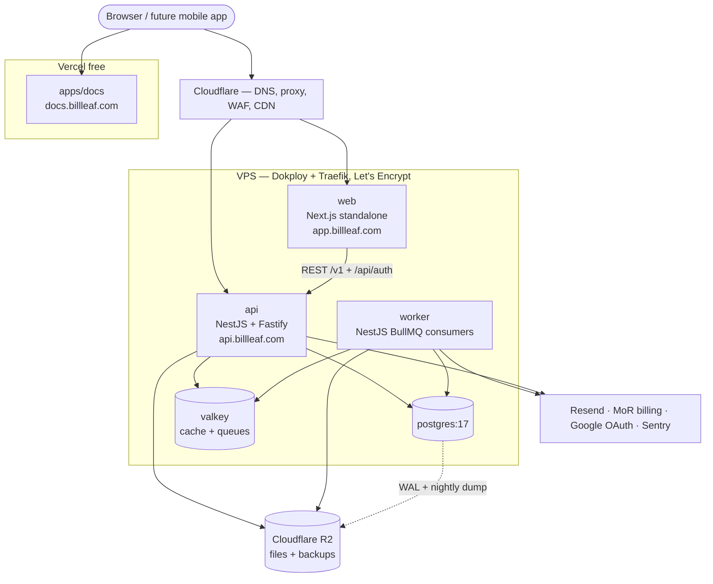

# Architecture Overview

Billleaf is a TypeScript monorepo with a **Next.js web app**, a **NestJS API** (which also runs as a **worker**), **PostgreSQL** and **Valkey** (Redis-compatible), self-hosted on a VPS managed by **Dokploy**. Static sites (docs, later marketing) run on **Vercel**.

## System diagram

## Components

| Component                | Tech                                                  | Responsibility                              | Doc                                                   |
| ------------------------ | ----------------------------------------------------- | ------------------------------------------- | ----------------------------------------------------- |
| `apps/web`               | Next.js 16, React 19, shadcn, TanStack Query, Zustand | Authenticated product UI                    | [web.md](web.md)                                      |
| `apps/api` (`main.ts`)   | NestJS 11 + Fastify, Drizzle, Better Auth             | REST API `/v1`, auth `/api/auth/*`, OpenAPI | [api.md](api.md)                                      |
| `apps/api` (`worker.ts`) | Same codebase, BullMQ                                 | Emails, PDFs, webhooks, scheduled jobs      | [background-jobs.md](background-jobs.md)              |
| `apps/docs`              | Fumadocs (Next)                                       | Public documentation (placeholder)          | [deployment](../infrastructure/deployment.md)         |
| PostgreSQL 17            | Drizzle schema in `packages/db`                       | System of record                            | [data-model.md](data-model.md)                        |
| Valkey                   | Redis protocol                                        | Queues, permission cache, rate limits       | —                                                     |
| Cloudflare R2            | S3 API                                                | File storage, backups                       | [backup-restore](../infrastructure/backup-restore.md) |

## Key decisions

- Shared truth lives in packages: schema in `packages/db`, API shapes and permission keys in `packages/contracts` → [monorepo.md](monorepo.md).
- Workspaces = Better Auth organizations; permissions are dynamic per workspace → [auth-and-rbac.md](auth-and-rbac.md).
- Shared DB, `workspace_id` on every business row → [multi-tenancy.md](multi-tenancy.md).
- RBAC ≠ entitlements ≠ platform admin → [billing-entitlements.md](billing-entitlements.md).
- All decisions with alternatives: [ADRs](../README.md#architecture-decision-records).

## Request flow (authenticated)

1. Browser → Cloudflare → Traefik → `api`.
2. Better Auth session cookie (on `.billleaf.com`) → session guard resolves user + active workspace.
3. `nestjs-cls` stores `userId`, `workspaceId`, `memberId` for the request.
4. `WorkspaceGuard` checks `@RequirePermission(...)` against the cached permission set; services call `EntitlementsService.assertWithinLimit()` for plan limits.
5. Controller → service → repository (always scoped by `workspace_id`).
6. Slow side effects (PDF, email) are queued to BullMQ and handled by `worker`.
