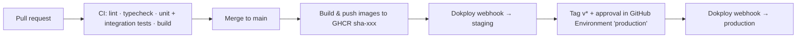

# Deployment

Decision: [ADR-0007 Self-hosted VPS + Dokploy](../adr/0007-self-hosted-vps-dokploy.md). Topology: [Architecture overview](../architecture/overview.md).

## Hosting

| Concern       | Choice                                                                                                                                          |
| ------------- | ----------------------------------------------------------------------------------------------------------------------------------------------- |
| Server        | 1× VPS (e.g. Hetzner CX32/CPX31, 4 vCPU / 8 GB). Scale vertically first, then move Postgres to its own VPS                                      |
| Orchestration | **Dokploy** (Docker Compose/Swarm with UI, zero-downtime deploys, Traefik + Let's Encrypt). Fallback: plain `docker compose` + Caddy (`infra/`) |
| Services      | `web` (Next standalone), `api`, `worker`, `migrate` (one-off), `postgres:17`, `valkey`                                                          |
| Storage       | Cloudflare R2 (files + backups)                                                                                                                 |
| Edge          | Cloudflare DNS + proxy (WAF, DDoS, static caching), SSL mode _Full (strict)_                                                                    |
| Static sites  | `apps/docs` (later marketing) on **Vercel free**, Git-integrated                                                                                |

## Images

- Built in GitHub Actions, pushed to **GHCR**: `ghcr.io/<org>/billleaf-web`, `ghcr.io/<org>/billleaf-api`.
- Tags: `sha-<short>` on every `main` build, plus `vX.Y.Z` on release tags. Never deploy `latest`.
- The **api image** runs three roles via command: `node dist/main.js` (api), `node dist/worker.js` (worker), `pnpm db:migrate`-equivalent (migrate).
- Web uses Next `output: "standalone"`; `NEXT_PUBLIC_*` values are build args per environment.

## Pipeline

## Deploy order (each environment)

1. **Migrate job** — run the api image with the migrate command against the target DB. Abort the deploy on failure.
2. **Permission sync** — on api boot (or part of migrate): upsert `PERMISSION_CATALOG` into `permissions`.
3. **api** and **worker** roll (health-checked on `/health`; Traefik switches only when healthy).
4. **web** rolls.

Migrations must be backward compatible with the currently running api (expand → deploy → contract in a later release).

## Rollback

- App: redeploy the previous image tag in Dokploy (one click) — safe because migrations are backward compatible.
- Data: never roll back migrations automatically; write a forward fix. For corruption, follow [backup-restore](backup-restore.md).

## Vercel (docs)

- Project root `apps/docs`, build via `turbo build --filter=docs`, ignored build step when `apps/docs` unchanged.
- Custom domain `docs.billleaf.com` via Cloudflare DNS (DNS-only, not proxied).

## First-time server setup (checklist)

- [ ] Harden VPS per [security checklist](security-checklist.md) (SSH keys, firewall, unattended upgrades).
- [ ] Install Dokploy; create projects `billleaf-staging`, `billleaf-production`.
- [ ] Add GHCR registry credentials (read-only token).
- [ ] Create Postgres + Valkey services with volumes; configure WAL archiving to R2.
- [ ] Create apps (web, api, worker) from GHCR images; set env vars; set domains.
- [ ] Copy each app's deploy webhook URL into GitHub Environment secrets.
- [ ] Point Cloudflare DNS records; enable proxy.
- [ ] Run first deploy; verify `/health`; run a restore drill.
