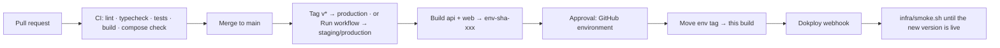

# Deployment

Decision: [ADR-0007 Self-hosted VPS + Dokploy](../adr/0007-self-hosted-vps-dokploy.md). Topology: [Architecture overview](../architecture/overview.md). How Dokploy works, costs, sizing and migrating from a manual VPS: [Hosting playbook](hosting-playbook.md).

## Hosting

| Concern       | Choice                                                                                                                                          |
| ------------- | ----------------------------------------------------------------------------------------------------------------------------------------------- |
| Server        | 1× VPS (e.g. Hetzner CX32/CPX31, 4 vCPU / 8 GB). Scale vertically first, then move Postgres to its own VPS                                      |
| Orchestration | **Dokploy** (Docker Compose/Swarm with UI, zero-downtime deploys, Traefik + Let's Encrypt). Fallback: plain `docker compose` + Caddy (`infra/`) |
| Services      | `web` (Next standalone), `api`, `worker`, `migrate` (one-off), `postgres:17`, `valkey`                                                          |
| Storage       | Cloudflare R2 (files + backups)                                                                                                                 |
| Edge          | Cloudflare DNS + proxy (WAF, DDoS, static caching), SSL mode _Full (strict)_                                                                    |
| Static sites  | `apps/docs` (later marketing): **Cloudflare Pages** (free, commercial use allowed) or the same VPS. Vercel Hobby is non-commercial only         |

## Images and tags

- CI builds two images and pushes them to **GHCR**: `ghcr.io/<owner>/billleaf-api` and `ghcr.io/<owner>/billleaf-web`.
- The **api image** runs three roles in the compose stack: `migrate` (`node dist/migrate.js`), `api` (default command) and `worker` (`dist/worker.js`).
- The **web image is built per environment**, because Next inlines `NEXT_PUBLIC_*` (API URL, Sentry DSN) at build time.
- Both images carry the git sha (`APP_VERSION`), shown by `GET /health/live` and `GET /healthz`.

| Tag                     | Meaning                                                                   | Who sets it                    |
| ----------------------- | ------------------------------------------------------------------------- | ------------------------------ |
| `<env>-sha-<7>`         | One immutable build for that environment. Use it to **pin or roll back**. | Build job                      |
| `vX.Y.Z`                | Release tag (production)                                                  | Build job, on `v*` tags        |
| `staging`, `production` | Moving pointer to what that environment should run                        | Deploy job, **after approval** |

There is no `latest`. Dokploy runs `IMAGE_TAG=production` (or `staging`) with `pull_policy: always`. The pointer only moves after the GitHub environment approval, so a restart can never pick up an unapproved build.

**Registry hygiene:** `.github/workflows/ghcr-cleanup.yml` runs weekly. It keeps the moving and version tags plus the 10 newest builds, and deletes the rest. Private packages on GitHub Free only get 500 MB.

## Pipeline

Workflow: `.github/workflows/deploy.yml`. Setup (variables, secrets, Dokploy app): [Dokploy runbook](dokploy-runbook.md).

## Deploy order (inside Dokploy)

The stack is **one Dokploy "Compose" app** using `infra/docker-compose.prod.yml` from this repo. Dependency conditions in the compose file enforce the order:

1. **postgres** and **valkey** are healthy.
2. **migrate** runs Drizzle migrations and syncs the permission catalog, then exits. If it fails, nothing else is replaced and the old version keeps serving.
3. **api** and **worker** start. The api is healthy on `/health/live`; the worker on a heartbeat file it touches every 30 seconds.
4. **web** starts once the api is healthy (`/healthz`). Traefik switches traffic to healthy containers only.

Migrations must be **backward compatible** with the running app (expand → deploy → contract in a later release).

## After every deploy: smoke test

`infra/smoke.sh` runs in the deploy job, and you can run it locally too. It waits until both services report the expected build, then checks:

- readiness (database, Redis);
- the sign-in page;
- the auth endpoint, and that CORS allows the web origin with cookies;
- with `HEALTH_CHECK_TOKEN`, the **deep check** `GET /health/deep`: database, Redis, an R2 write/read/delete, a PDF render, the job queue, and a live worker (heartbeat).

`/health/deep` returns 404 unless the token matches.

## Rollback

- **App:** in Dokploy set `IMAGE_TAG=production-sha-<previous>` and redeploy. This is safe because migrations are backward compatible. Set it back to `production` with the next release.
- **Data:** never roll back migrations automatically; write a forward fix. For corruption, follow [backup-restore](backup-restore.md).

## Container defaults

Every service in the production compose has:

- a **health check** and `restart: unless-stopped`;
- a **memory limit**: api and worker 768 MB, web 512 MB, Postgres 1 GB, Valkey 256 MB;
- **log rotation**: 3 × 10 MB.

The app images run as a **non-root** user. Valkey uses `noeviction`, so BullMQ jobs are never dropped under memory pressure. The worker gets 60 seconds to finish in-flight jobs on deploy.

**PDF fonts:** Chinese, Japanese and Korean fonts (4–9 MB each) aren't in the image. The first PDF that needs one downloads it from `raw.githubusercontent.com` (pinned release, SHA-256 checked) into the `pdffonts` volume, shared by api and worker, so the server needs outbound HTTPS to that host. To fetch them all up front: `docker compose exec api node dist/fetch-cjk-fonts.js`. Without access, those characters print as boxes and a warning is logged.

## Docs site

`apps/docs` is a static site ([ADR-0016](../adr/0016-docs-site.md)); it needs no server, database or secrets.

- **Build:** `pnpm turbo build --filter=docs` → `apps/docs/out`. Set `NEXT_PUBLIC_APP_URL` (links back to the app) at build time.
- **Host:** Cloudflare Pages (free, commercial use allowed): build command above, output directory `apps/docs/out`. Vercel works too, but commercial use needs the Pro plan ($20/month).
- **Domain:** e.g. `docs.<your-domain>` via Cloudflare DNS. Then set the `DOCS_URL` GitHub variable so the web app's Help and Docs links point there (`NEXT_PUBLIC_DOCS_URL`, baked in at build).
- **API reference:** after API route changes, run `pnpm gen:api-client && pnpm --filter docs gen:api` and commit the result.

## First-time setup

Follow the [Dokploy runbook](dokploy-runbook.md): server, Dokploy, Cloudflare, R2, email, GHCR access, GitHub environments, the compose app, first deploy and restore drill. Every variable is listed in [`infra/.env.production.example`](../../infra/.env.production.example).
