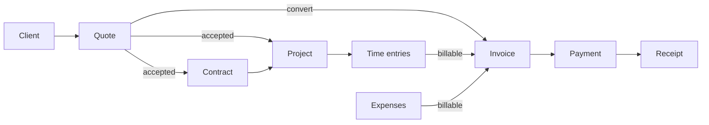

# Modules

Proposed product modules. Each maps to one API module under `apps/api/src/modules/<name>` and one web feature under `apps/web/features/<name>` — see [Adding a module](../engineering/adding-a-module.md).

| Module                 | Purpose                                                      | Key entities                        | Phase         |
| ---------------------- | ------------------------------------------------------------ | ----------------------------------- | ------------- |
| **Workspace**          | Business profile, branding, members, roles, settings         | workspace, member, role, invitation | 0–1           |
| **Clients**            | Client profiles, contacts, history                           | client, contact                     | 1             |
| **Quotes**             | Quotations / proposals, accept → contract/project/invoice    | quote, quote_line                   | 1             |
| **Invoices**           | Issue invoices, taxes, multi-currency, PDF + email, status   | invoice, invoice_line, tax_rate     | 1             |
| **Credit notes**       | Corrections and partial refunds of issued invoices           | credit_note, credit_note_line       | 2             |
| **Payments**           | Record (later: collect online) payments against invoices     | payment                             | 1             |
| **Receipts**           | Generate receipts for recorded payments                      | receipt                             | 1             |
| **Projects**           | Projects, tasks, milestones, deadlines                       | project, task, milestone            | 2             |
| **Time**               | Clockify-style tracker, tags, billable hours → invoice lines | time_entry                          | 2             |
| **Contracts**          | Agreement templates and documents (e-sign later)             | contract, contract_template         | 2             |
| **Expenses**           | Spending with receipts, rebilling to clients, profit & loss  | expense, expense_category           | 2             |
| **Files**              | Attachments stored in R2                                     | file                                | 1+            |
| **Notifications**      | In-app + email notifications                                 | notification                        | 1+            |
| **Billing** (internal) | Billleaf's own SaaS subscription & entitlements              | workspace_subscription              | 0 (live in 2) |

## Journey and hand-offs

## Cross-cutting rules

- Every business row belongs to a workspace (`workspace_id`) — [Multi-tenancy](../architecture/multi-tenancy.md).
- Issued financial documents (quote sent, invoice issued, receipt) are **immutable**; corrections use void / credit note.
- Document numbers (`QUO-0001`, `INV-0001`, `RCP-0001`) are per workspace and gap-free — [Data model](../architecture/data-model.md).
- Every action is guarded by a permission key (`invoice.create`) — [Auth & RBAC](../architecture/auth-and-rbac.md).
- Plan limits are checked via entitlements — [Billing & entitlements](../architecture/billing-entitlements.md).
